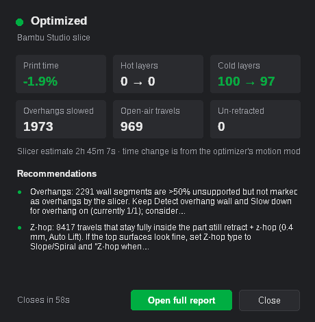

# Bambu Print Optimizer

Free, open-source (MIT), local "Helio-style" thermal check and speed/fan optimizer for Bambu Studio G-code. Windows installer, no Python needed.

**Code signing policy:** see [below](#code-signing-policy).

A Python tool that checks a sliced Bambu Studio print and tweaks it, all on your PC with no cloud upload:

1. **Thermal check ("Assess"-like).** It estimates how hot each island of each layer is when the next layer goes on top. It flags layers that are too hot (sagging, curling, blobby small parts) or too cold (weak layer bonding, warping on ABS/ASA). You get a heat map and charts in an HTML report.
2. **Speed/fan changes ("Enhance"-like).**
   - Too-hot layers get slowed down, plus a little more fan if the material allows it.
   - Cool layers with headroom get faster inner walls and infill. Outer walls and top surfaces are never sped up.
   - Every change stays inside the filament's max volumetric flow and the machine's limits.
   - ABS/ASA layers that run too cold get less fan.
3. **Overhangs and bridges.** Each wall segment is compared with the layer below. Overhangs over 50% that the slicer didn't mark get your profile's own overhang speed, plus an overhang-fan boost (PLA/PETG/TPU). Bridges printed below the overhang fan speed get their fan raised.
4. **Travel and stringing.**
   - It finds travels that cross open air and checks whether each one retracts first.
   - Optionally, it adds the missing retraction (`--fix-strings`).
   - Optionally, it re-orders infill islands within a feature to shorten travel (`--reorder`). Walls are never re-ordered.
5. **Slicer-setting tips.** The report lists Bambu Studio settings worth changing for problems that are better fixed in the slicer.

**Rules it always follows:**
- It only changes feedrates (F), part-fan values (M106 S) and M73 remaining-time values. It can also insert `M106` and `G1 F` lines, and net-zero retract/unretract pairs when `--fix-strings` is on.
- It never touches: E values, temperatures, the first 2 layers' speeds, start/end G-code, AMS/filament-change blocks (M620/M621), firmware conditional blocks (M622/M623: timelapse, H2S nozzle-clumping checks), or anything before the first layer or after the end G-code.
- Every output is re-parsed and checked before it is saved:
  - same number of layers
  - same extrusion per layer (to 1e-6 mm)
  - same set of extrusion moves
  - start/end and protected blocks byte-identical
  - no extruding while retracted
  - feeds within the limits
  - flow under the filament limit
- If any check fails, **your G-code is left unchanged** and the report says why.


## Install (Windows 10/11)

1. Download `PrintOptimizer-Setup-<version>.exe` from the [Releases](https://github.com/drewrobinso/bambu-print-optimizer/releases) page.
2. Close Bambu Studio, then run the installer. There are two clicks: **Next** on the options page, then **Finish**.
   - It installs for your Windows user only, with no admin rights, to `%LOCALAPPDATA%\Programs\PrintOptimizer`.
   - Python, shapely and numpy are bundled. You don't need to install anything else.
   - Option *Add AI process presets to Bambu Studio* (on by default). For every Bambu Lab printer you added in Bambu Studio, it creates presets named `<layer>mm <printer> AI <Goal>`. Each one **inherits** the matching system process preset (so you keep getting Bambu's updates) and runs the optimizer with that goal.
     - Layer heights: the main system layer heights only (Standard / Optimal / Fine / Draft, not High Quality, Strength and similar variants), at most 3 per printer and nozzle: the printer's default layer height and its nearest neighbours.
     - Goals: `Balanced`, `Speed` and `Quality` (`--goal balanced/speed/quality`).
     - For an **H2S with a 0.4 nozzle** that is 9 presets: `0.16mm H2S AI Balanced`, `0.16mm H2S AI Speed`, `0.16mm H2S AI Quality`, `0.20mm H2S AI Balanced`, `0.20mm H2S AI Speed`, `0.20mm H2S AI Quality`, `0.24mm H2S AI Balanced`, `0.24mm H2S AI Speed`, `0.24mm H2S AI Quality` (based on `0.16/0.20/0.24mm Standard @BBL H2S`).
     - Nozzles other than 0.4 mm get the size in the name, for example `0.30mm H2S 0.6 AI Balanced`. The X1 Carbon is shortened to `X1C`.
     - The presets are written into **every** Bambu Studio user folder: `%APPDATA%\BambuStudio\user\<account id>\process\` for each signed-in account, `user\default\` (signed out), and the active folder named in `BambuStudio.conf` (`preset_folder`). Bambu Studio only loads the folder of the account you are signed in with.
     - Presets this tool already created are updated in place. Your own tweaks and the Bambu cloud id are kept, and the preset is marked for upload. A preset of yours that happens to have the same name is never changed.
     - **Upgrading from 1.0/1.1:** the old `... - Optimized` presets (marked ones, or older manual ones whose post-processing line points at `bambu_optimizer.py` / `PrintOptimizer`) are backed up to `%LOCALAPPDATA%\Programs\PrintOptimizer\preset_backups\`, then retired.
       - If preset sync is off, which is Bambu Studio's default, or the old preset isn't synced, it is deleted.
       - If it is synced to your Bambu account (Bambu Studio's *Sync user presets* setting is on, `app.sync_user_preset` in `BambuStudio.conf`), its post-processing line is cleared and a note is added. Bambu Studio can delete a cloud preset only through its own Delete command; a cloud preset deleted on disk is downloaded again at the next sync. **Delete it in Bambu Studio** (select it → Delete).
   - Start menu: **Print Optimizer** (pick a sliced `.gcode.3mf` and optimize it by hand), **Add Bambu Studio presets** (run it again after adding a printer in Bambu Studio), and **Print Optimizer reports** (opens the reports folder).
   - The finish page says what happened: how many presets were added, or that no Bambu Lab printer was found. Printers are detected from `BambuStudio.conf` (`presets.machine`, `models`) and from your user printer presets.
3. Start Bambu Studio, pick an AI preset such as `0.20mm H2S AI Balanced`, and slice as usual.

**Uninstall:** Windows Settings → Apps → *Bambu Print Optimizer* → Uninstall (or the Start menu entry). This removes the program and the shortcuts, and cleans up the same user folders.
- The `... AI <Goal>` presets (and any old `... - Optimized` ones) that belong to this tool are deleted.
- Presets that are synced to your Bambu cloud account (only when preset sync is on) are kept, but their post-processing line is cleared. Deleting them locally would make Bambu Studio download the cloud copy again, still pointing at the removed exe, and slicing would fail. Delete them in Bambu Studio if you don't want them.
- Your reports in `Documents\BambuPrintOptimizer` and the preset backups are kept.

**Silent install** (for scripting): `PrintOptimizer-Setup-<version>.exe /VERYSILENT /SUPPRESSMSGBOXES`. Add `/TASKS="startmenu"` to skip the presets.

## What you see when you slice

- A small progress window (dark theme, Bambu green) shows the stages *Parsing G-code → Thermal analysis → Optimizing → Verifying → Writing*, a real progress bar, and elapsed time.
  - **Cancel** stops it and leaves Bambu's G-code exactly as sliced. Bambu continues normally.
  - No console window appears. The program is a Windows GUI-subsystem exe.
- When it finishes, the G-code is written first. Then a **results card** opens in its own process, so Bambu Studio continues straight away. The card shows:
  - the status: *Optimized*, *No changes needed*, or *Check failed — G-code left unchanged*
  - the goal, the print-time change (and how much of it came from faster acceleration), hot and cold layers before → after, the number of overhang segments slowed, and open-air and un-retracted travels
  - the top recommendations, in full. Long text wraps and the list scrolls if the screen is too small; the buttons are always visible.
  - The windows are DPI-aware, so they are sharp and sized correctly at 125%, 150% or 200% Windows display scaling (see `screens/ui_scaling/`, made by `test/ui_shots.py`).
  - **Open full report** (the HTML report with heat maps and charts)
  - It closes itself after 60 s unless you click it.
- Reports, the summary JSON and `optimizer.log` are saved in `Documents\BambuPrintOptimizer\reports\`. A Documents folder moved to OneDrive is found through the Windows known-folder API.

| Screen | |
|---|---|
| Progress |  |
| Results card |  |
| Installer |  |

## How it hooks into Bambu Studio

These points were checked in the Bambu Studio source and the 02.09.01.70 binary.
- After slicing, Bambu Studio runs each line of *Process → Others → Post-processing scripts*, with the temporary G-code path as the last argument. The installer's preset sets it to:
  ```
  "C:\Users\<you>\AppData\Local\Programs\PrintOptimizer\PrintOptimizer.exe" --goal balanced
  ```
  (`--goal speed` / `--goal quality` for the AI Speed / AI Quality presets).
- On Windows, Bambu starts it with `CreateProcessW`, then `WaitForSingleObject(INFINITE)` and `GetExitCodeProcess`. Slicing waits until the optimizer exits.
  - Bambu does **not** hide the console window (that code is `#if 0` in the source). That is why the tool ships as a windowed exe (or use `pythonw.exe` with the Python version below).
- The script edits the file in place. Bambu re-loads the preview from it, and the plate file you Print / Send / Export is packaged from it.
- **Bambu's own time/filament estimate stays from the original slice.** The optimizer updates the `M73` remaining-time values the printer shows, and the results card and report show its own before/after model times.
- Exit code: it always exits 0 (also on Cancel or an internal error, which leaves the G-code untouched) unless you add `--strict`.
- The presets can be edited like any other preset. For example, add `--reorder --fix-strings` to the post-processing line.

## Without the installer (Python version)

Use `BambuPrintOptimizer-<version>-python.zip`. It is flat: the files sit at the zip root. Unzip it to `C:\BambuPrintOptimizer`.
1. Install Python 3.11+ (python.org; tick "Add python.exe to PATH"), then run `py -m pip install --user shapely numpy`.
2. Post-processing line. Use **pythonw.exe**, so no console window appears:
   ```
   "C:\Users\<you>\AppData\Local\Programs\Python\Python312\pythonw.exe" "C:\BambuPrintOptimizer\bambu_optimizer.py" --goal balanced
   ```
   Or create the presets automatically: `py C:\BambuPrintOptimizer\bambu_optimizer.py --install-presets` (and `--remove-presets` to undo).
3. Standalone: `py C:\BambuPrintOptimizer\bambu_optimizer.py "C:\path\plate.gcode.3mf"` writes `plate.optimized.gcode.3mf`, with the G-code and its MD5 updated. Plain `.gcode` works too (`-o out.gcode`, or in place).

## The three goals

Each `AI <Goal>` preset runs the optimizer with that goal. `test/goal_matrix.py` checks these rules on the six reference prints.

| Goal | Promise | What it does |
|---|---|---|
| **Speed** | Print time is **never longer** than Bambu's original. | Speeds up inner walls and infill up to 1.5× and raises their acceleration up to the machine maximum. Hot layers get more fan first (free). Slowdowns for cooling or overhangs only stay if the speed-ups pay for them; otherwise the lowest-value ones are dropped, and the hot layers left over are listed as the first recommendation. |
| **Balanced** (default) | Fixes most hot layers, print time **at most +2%**. | Same tools with a 1.25× speed-up cap and 1.5× acceleration. If the fixes would cost more than 2%, the least important slowdowns are dropped first. |
| **Quality** | Thermal and overhang quality first; may add time. | No feed speed-ups, a bigger temperature safety margin (5 °C), 25–50% overhangs are slowed too, acceleration only +20% and only on sparse/internal solid infill. Ends with no more hot layers than Balanced and at least as many overhang slowdowns. |

The time limit is checked twice: on the plan, and again on the written G-code with the same estimator that sets the M73 remaining time. Run with `--no-time-limit` to get the old behaviour (fixes are applied whatever they cost).

**Speed-aware acceleration** (M204), applied per Bambu `;FEATURE:` type:
- Raised: sparse infill, internal solid infill and inner walls (Quality: infill only), never above `machine_max_acceleration_extruding` from the G-code header and never below the preset's own value.
- Never raised: outer walls, overhangs, bridges, top surfaces, the first 3 layers, wipes, and anything inside protected AMS / tool-change / timelapse blocks.
- The slicer's value is put back at every feature change, layer change and before every protected block, and the built-in validator rejects the output if any other extrusion move has a different acceleration.
- The motion model includes the new acceleration, so the M73 remaining time is right. The time saved by acceleration is shown separately on the results card and in the report.
- Hot layers never get faster acceleration: it would shorten their cooling time. `--no-accel` turns this off.

## Options

| Option | Meaning |
|---|---|
| `--goal quality / balanced / speed` | See [The three goals](#the-three-goals). Default: balanced. |
| `--no-accel` | Keep the slicer's accelerations (no M204 changes). |
| `--no-time-limit` | Let Speed/Balanced add whatever time the fixes cost (pre-1.3 behaviour). |
| `--max-speedup 1.15` | Your own cap on the speed-up. |
| `--dry-run` | Report only. |
| `--reorder` | Re-order infill islands to shorten travel (off by default). |
| `--fix-strings` | Add a retraction to un-retracted travels that cross more than 2 mm of open air (off by default). |
| `--chamber 45` | Chamber temperature to assume (°C). Default: the profile's chamber temperature, or 35 °C for enclosed printers. |
| `--material ASA` | Override the filament type used by the model. |
| `--skip-layers 2` | Never change speeds on the first N layers. |
| `--no-speed`, `--no-fan`, `--no-overhang`, `--no-bridge-fan`, `--no-m73` | Turn off individual parts. |
| `--no-gui` | No progress window and no results card (the old console behaviour). |
| `--open` | Also open the full HTML report in the browser when done. |
| `--auto-close 60` | Seconds before the results card closes itself (0 = never). |
| `--keep-original` | Save a copy of the un-optimized G-code next to the report. |
| `--report-dir DIR` | Folder for reports. |
| `--strict` | Return an error on failure (Bambu then shows a message). |
| `--install-presets` / `--remove-presets` | Create / remove the `... AI <Goal>` Bambu Studio presets. `--pp-args "..."` adds extra arguments to their post-processing line, after their own `--goal`. |
| `--open-reports` | Open the reports folder. |

## How the thermal model works, and its limits compared with Helio (please read)

Helio Additive runs a **calibrated physics simulation** in the cloud. They measured material data for each filament/printer combination, and run it on their GPUs. **This tool is not that.** It is a lumped, uncalibrated engineering model:
- Each layer is split into islands, using the union of the extrusion paths.
- Each island's surface temperature decays toward the chamber temperature with a time constant that shrinks with part-fan speed.
- It is "re-heated" each time a new layer is deposited, and heat carries over from island to island through their overlap with the layer below.
- The material windows (for example PLA 30–70 °C, PETG 45–92 °C, ASA 68–120 °C interlayer) are estimates in `materials.py`. You can tune them.

What that means:
- The temperatures are good for **comparing layers and before/after**. They are not real °C, and nothing here has been checked against a thermocouple or a real print.
- Small, fast layers (spires, pins) are flagged reliably because the physics is simple. Mild cases are judgment calls.
- Time numbers come from its own motion planner (accel + junction-speed model). On the six test slices it came out 5–20% lower than Bambu's own "model printing time", depending on the print. Use the percentage change, not the absolute minutes.
- It **cannot re-route travels around walls**. Bambu's "Avoid crossing wall" setting does that properly, so the report recommends it.
- Retractions and z-hops are only analysed, never removed. Removing them can cause nozzle collisions.
- Overhang detection is geometric and somewhat stricter than Bambu's own overhang labelling. 25–50% overhangs are report-only. Above 50%, it uses the overhang speeds from your profile. Use `--no-overhang` if you disagree.
- **No speed-ups on real prints have been measured yet.** Print a test part before trusting it on something important.


## Privacy

This program will not transfer any information to other networked systems unless specifically requested by the user or the person installing or operating it.
- Everything runs locally. There is no telemetry, no update check, and no network access.
- The only files it writes are:
  - the G-code it is given
  - reports and logs in `Documents\BambuPrintOptimizer`
  - its own install folder
  - with the preset option, the preset files in `%APPDATA%\BambuStudio\user\<id>\process`
- If you are signed in to Bambu Studio, Bambu Studio may sync those user presets to your Bambu cloud account, as it does with any user preset. That is Bambu Studio's behaviour, under Bambu Lab's privacy policy.

## Code signing policy

Free code signing provided by [SignPath.io](https://about.signpath.io), certificate by [SignPath Foundation](https://signpath.org).

- Committers and reviewers: [Andrew Robinson (@drewrobinso)](https://github.com/drewrobinso)
- Approvers: [Andrew Robinson (@drewrobinso)](https://github.com/drewrobinso)
- Privacy policy: see [Privacy](#privacy). This program will not transfer any information to other networked systems unless specifically requested by the user or the person installing or operating it.

How releases are signed:
- Release binaries are built from this repository by GitHub Actions on GitHub-hosted runners (`.github/workflows/release.yml`). They are then submitted to SignPath.
- Every signing request is approved manually by an approver.
- Only this project's own files are signed: `PrintOptimizer.exe` and `PrintOptimizer-Setup-<version>.exe`. The signing rules are in [`packaging/signpath/`](packaging/signpath/).
- The bundled open-source runtime files (Python, numpy, shapely/GEOS, Tcl/Tk) are shipped as published upstream.

## Building

**Windows (same as CI):** Python 3.12 x64 and Inno Setup 6 (`choco install innosetup`), then `powershell -File scripts\build_windows.ps1`. The output goes to `dist\`:
- `PrintOptimizer\`: the windowed one-folder app (PyInstaller)
- `PrintOptimizer-Setup-<version>.exe`: the installer (Inno Setup, per-user)
- `BambuPrintOptimizer-<version>-python.zip`: the flat Python-source zip

Pinned build inputs are in `requirements-build.txt`. numpy is pinned to 1.26.4 because numpy 2.x does not run under Wine 10, which the Linux build uses.

**Linux (unsigned local test builds, through Wine):** `scripts/build_wine.sh`. One-time setup of the Wine prefix:
```
WINEPREFIX=/path/prefix wine python-3.12.10-amd64.exe /quiet InstallAllUsers=0 TargetDir='C:\Python312' Include_test=0
WINEPREFIX=/path/prefix wine innosetup-6.7.4.exe /VERYSILENT /CURRENTUSER /DIR='C:\InnoSetup'
WINEPREFIX=/path/prefix wine 'C:\Python312\python.exe' -m pip install -r requirements-build.txt
```

**Releases:**
1. Bump `VERSION` in `src/bambu_optimizer.py`.
2. Push a tag `v<version>`.
3. The workflow builds, self-tests the frozen exe, and submits the app and then the installer to SignPath (each needs approval).
4. It creates a **draft** GitHub release with the signed installer, the Python zip, and `SHA256SUMS.txt`. Unsigned builds are never published.

SignPath one-time setup:
- Repository secret `SIGNPATH_API_TOKEN`.
- Repository variables `SIGNPATH_ORGANIZATION_ID`, `SIGNPATH_PROJECT_SLUG`, `SIGNPATH_SIGNING_POLICY_SLUG`.
- Artifact configurations `app` and `installer` in SignPath, from `packaging/signpath/*.xml`.

**Local test signing:** `scripts/test_sign.sh` creates a throw-away self-signed certificate in `signing/` (gitignored) and signs copies into `dist/test-signed/`. This only checks the signing and timestamp pipeline. **Never distribute these files.**

## Files

- `src/bambu_optimizer.py`: CLI / post-processing entry point (.gcode and .gcode.3mf), GUI flow, presets and Start-menu modes
- `src/ui.py`, `src/progress.py`: progress window and results card (tkinter), staged progress reporting with cancel
- `src/bambu_presets.py`: creates, migrates and removes the Bambu Studio `... AI <Goal>` presets
- `src/gcode_model.py`: G-code parser, protected-block detection, motion-time estimator
- `src/optimizer.py`: geometry (islands, overhangs), thermal model, speed/fan plan, travel/stringing, island re-ordering
- `src/emitter.py`: writes the new G-code, updates M73, runs the safety validation
- `src/report.py`: HTML report with inline SVG charts and heat maps (works offline)
- `src/materials.py`: material presets and model constants
- `test/verify.py`: an independent checker: `python verify.py original.gcode optimized.gcode [--reordered]`
- `packaging/`: PyInstaller spec, Inno Setup script, icon, SignPath artifact configurations
- `scripts/`: build scripts (Windows / Wine), portable zip, local test signing

## Test results (box, 2026-11-21, 1.3.0)

These are model and estimator results only. Nothing has been printed yet.

The test G-code came from the **Bambu Studio 02.09.01.70 CLI** using the official **Bambu Lab H2S 0.4 nozzle** machine profile (including its real start/end, timelapse and filament-change templates), `0.20mm Standard @BBL H2S`, and Bambu filament profiles. The models were a 60×60 mm test plate with an 8 mm spire, a cylinder and a bridge (225 layers), and the Metra-style speaker adapter (166 layers, ~86 g PETG). 
Results for all three goals (1.3.0, `python3 test/goal_matrix.py`). "of which accel" is the part of the time change that comes from the raised accelerations alone. The time is the optimizer's own motion model of the written G-code (the same one that sets M73).

| Print | Goal | Time | of which accel | Hot layers | Cold layers | Overhangs slowed | Valid |
|---|---|---|---|---|---|---|---|
| tower_pla | speed | -3.02% | -2.37% | 101 → 2 | 0 → 0 | 16 | PASS |
| tower_pla | balanced | -0.84% | -1.46% | 101 → 2 | 0 → 0 | 16 | PASS |
| tower_pla | quality | +3.51% | -0.51% | 101 → 2 | 0 → 0 | 26 | PASS |
| tower_petg | speed | -7.32% | -1.15% | 44 → 0 | 8 → 8 | 16 | PASS |
| tower_petg | balanced | -6.43% | -0.73% | 44 → 0 | 8 → 8 | 16 | PASS |
| tower_petg | quality | +0.06% | -0.26% | 44 → 0 | 8 → 9 | 26 | PASS |
| tower_abs | speed | -5.63% | -0.85% | 0 → 0 | 8 → 7 | 16 | PASS |
| tower_abs | balanced | -5.48% | -0.56% | 0 → 0 | 8 → 7 | 16 | PASS |
| tower_abs | quality | -0.21% | -0.21% | 0 → 0 | 8 → 8 | 26 | PASS |
| tower_asa | speed | -4.66% | -0.85% | 98 → 96 | 4 → 4 | 16 | PASS |
| tower_asa | balanced | -4.51% | -0.56% | 98 → 96 | 4 → 4 | 16 | PASS |
| tower_asa | quality | +0.72% | -0.21% | 98 → 96 | 4 → 4 | 26 | PASS |
| speaker_petg | speed | -6.21% | -4.00% | 0 → 0 | 100 → 84 | 1965 | PASS |
| speaker_petg | balanced | -4.32% | -2.43% | 0 → 0 | 100 → 88 | 1965 | PASS |
| speaker_petg | quality | -0.66% | -1.10% | 0 → 0 | 100 → 99 | 2187 | PASS |
| speaker_asa | speed | -4.19% | -4.20% | 0 → 0 | 46 → 46 | 1965 | PASS |
| speaker_asa | balanced | -2.43% | -2.51% | 0 → 0 | 46 → 46 | 1965 | PASS |
| speaker_asa | quality | -0.68% | -1.14% | 0 → 0 | 46 → 46 | 2187 | PASS |

All rules passed on every print: Speed ≤ 0%, Balanced ≤ +2% and fixes at least half of the fixable hot layers, Quality hot ≤ Balanced, Quality overhangs ≥ Balanced, and time(Speed) ≤ time(Balanced) ≤ time(Quality). Stress cases (Speed and Balanced with speed-ups and acceleration turned off, so only slowdowns are available) also stayed within their limits by dropping the lowest-value slowdowns: Speed +0.00%, Balanced +1.78%.

Compared with 1.2.1, Speed on the ASA speaker went from +0.03% to −4.19%, and on the PLA tower from −0.81% to −3.02%.

Notes:
- Tower ASA: the spire is already at Bambu's minimum speed and the ASA fan cap is 40%, so 96 layers stay flagged even on Quality, and the report recommends a cooling tower or multiple copies.
- Speakers: 25–39% of extrusion time is at the filament's flow limit, so most of the gain comes from acceleration. The big flange layers are "cold" and need a warmer chamber, which post-processing can't provide.

Every output passed both the built-in validator and the independent `verify.py`:
- same layer count
- per-layer extrusion difference 0.0 mm
- start/end/temperature/AMS/timelapse lines identical
- only F, fan S and M73 R values changed, plus inserted `G1 F` / `M106` / `M204` lines
- the acceleration in effect at every feature change, layer change and AMS block is the slicer's own, and never above the machine maximum

With `--reorder --fix-strings`:
- travel in re-orderable infill runs went down 0.7–2.4% (for example, 83.8 m → 81.7 m on the speaker)
- 2–12 retractions were added on un-retracted open-air travels
- extrusion moves stayed identical as a set, and still passed both checks


The Windows build was tested under Wine 10 on the build box. Not yet on a real Windows PC:
- Silent and interactive install, upgrade in place, and uninstall all worked.
- The presets were created for the configured printers and later removed. A user's own preset with the same name was left untouched.
- The frozen exe, run the way Bambu runs it (temp file, `SLIC3R_PP_*` variables), produced G-code **byte-identical** to the Linux Python run. It passed `verify.py`.
- Cancel left the file unchanged and exited 0.
- The results card ran detached after the exe returned.
