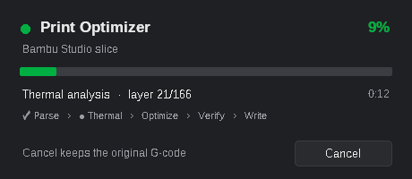
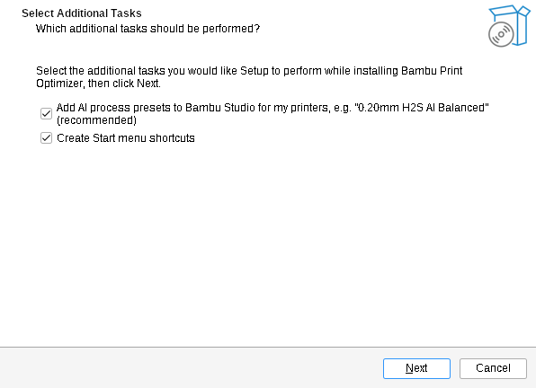

<p align="center"></p>

# EmberCheck — Print Optimizer for Bambu Studio

Free, open-source (MIT), local "Helio-style" thermal check and speed/fan optimizer for Bambu Studio G-code, for every Bambu Lab printer. Windows installer, no Python needed. A Python zip is also available for macOS (preview, untested) and other systems; see [docs/macos.md](docs/macos.md).


Repository: https://github.com/drewrobinso/embercheck

[](https://buymeacoffee.com/drewrobinso)

What changed in each version: [CHANGELOG.md](CHANGELOG.md). How each optimization works: [docs/](docs/README.md).

**Code signing policy:** see [below](#code-signing-policy).

A Python tool that checks a sliced Bambu Studio print and tweaks it, all on your PC with no cloud upload:

1. **Thermal check ("Assess"-like).** It estimates how hot each island of each layer is when the next layer goes on top. It flags layers that are too hot (sagging, curling, blobby small parts) or too cold (weak layer bonding, warping on ABS/ASA). You get a heat map and charts in an HTML report.
2. **Speed/fan changes ("Enhance"-like).**
   - Too-hot layers get slowed down, plus a little more fan if the material allows it.
   - Cool layers with headroom get faster inner walls and infill. Outer walls and top surfaces are never sped up.
   - Every change stays inside the filament's max volumetric flow and the machine's limits.
   - ABS/ASA layers that run too cold get less fan.
3. **Overhangs and bridges.** Each wall segment is compared with the layer below. Overhangs over 50% that the slicer didn't mark get your profile's own overhang speed, plus an overhang-fan boost (PLA/PETG/TPU). Bridges printed below the overhang fan speed get their fan raised.
4. **Travel and stringing.**
   - It finds travels that cross open air and checks whether each one retracts first.
   - Optionally, it adds the missing retraction (`--fix-strings`).
5. **Faster motion without touching the extrusion (1.3/1.4).**
   - Speed-aware acceleration (M204) on infill and inner walls ([docs/acceleration.md](docs/acceleration.md)).
   - Smart travel order: infill islands within one feature are re-ordered (nearest neighbour + 2-opt) to shorten travel. Walls are never re-ordered ([docs/travel-order.md](docs/travel-order.md)).
   - Z-hop / retraction skip on short infill travels that stay over printed area (Speed: hop + retract, Balanced: hop only, Quality: off) ([docs/hop-retract-skip.md](docs/hop-retract-skip.md)).
   - ArcWelder-style arc fitting (G2/G3) with the exact same E, on printers without Bambu's curve planning ([docs/arc-fitting.md](docs/arc-fitting.md)).
6. **Slicer-setting tips.** The report lists Bambu Studio settings worth changing for problems that are better fixed in the slicer.

**Rules it always follows:**
- It changes feedrates (F), part-fan values (M106 S), accelerations (M204) and M73 remaining-time values, and can insert `M106`, `G1 F` and `M204` lines (plus net-zero retract/unretract pairs with `--fix-strings`).
- Inside one infill feature it may also re-order whole islands, drop the Z lift/lower (and, on Speed, the wipe + retract/un-retract pair whose E adds up to exactly 0) of short travels over printed area, and replace runs of G1 segments by G2/G3 arcs whose E is the exact decimal sum of the replaced moves.
- It never touches: the E of any extrusion move (per-layer extrusion stays identical to the last decimal), temperatures, the first 2 layers' speeds, start/end G-code, AMS/filament-change blocks (M620/M621), firmware conditional blocks (M622/M623: timelapse, H2S nozzle-clumping checks), or anything before the first layer or after the end G-code.
- Every output is re-parsed and checked before it is saved:
  - same number of layers
  - same extrusion per layer (to 1e-6 mm)
  - same set of extrusion moves (arcs are expanded back into the segments they replace and checked point by point)
  - start/end and protected blocks byte-identical
  - no extruding while retracted
  - feeds within the limits
  - flow under the filament limit
- If any check fails, **your G-code is left unchanged** and the report says why.


## Install (Windows 10/11)

> Privacy: EmberCheck collects and sends no data ([PRIVACY.md](PRIVACY.md)). Code signing: [CODE_SIGNING.md](CODE_SIGNING.md). SignPath Foundation signing is pending, so current releases are unsigned.

1. Download `EmberCheck-Setup-<version>.exe` from the [Releases](https://github.com/drewrobinso/embercheck/releases) page.
2. Close Bambu Studio, then run the installer: **Next** on the options page, pick your printers on the **printers page**, then **Finish**.
   - It installs for your Windows user only, with no admin rights, to `%LOCALAPPDATA%\Programs\EmberCheck`.
   - Python, shapely and numpy are bundled. You don't need to install anything else.
   - Option *Add EmberCheck process presets to Bambu Studio* (on by default). After the files are copied, a **printer page** lists every Bambu Lab model in Bambu Studio's own system profiles (`BBL.json`, so new models appear without an EmberCheck update: X1 Carbon, X1, X1E, P1P, P1S, P2S, A1 mini, A1, A2L, H2D, H2D Pro, H2S, H2C, X2D, H3C in 02.09). The printers you set up in Bambu Studio (`BambuStudio.conf` and your user printer presets) are pre-checked.
   - For every checked printer and **every nozzle** its system profiles offer, it creates presets named `<layer>mm <printer> EmberCheck <Goal>`. Each one **inherits** the matching system process preset of that exact printer and nozzle (so you keep getting Bambu's updates), has `compatible_printers` set to that printer/nozzle, and runs EmberCheck with that goal.
     - Layer heights: the main system layer heights only (Standard / Optimal / Fine / Draft, not High Quality, Strength and similar variants), at most 3 per printer and nozzle: the printer's default layer height and its nearest neighbours.
     - Goals: `Balanced`, `Speed` and `Quality` (`--goal balanced/speed/quality`).
     - For an **H2S with a 0.4 nozzle** that is 9 presets: `0.16mm H2S EmberCheck Balanced`, `0.16mm H2S EmberCheck Speed`, `0.16mm H2S EmberCheck Quality`, `0.20mm H2S EmberCheck Balanced`, `0.20mm H2S EmberCheck Speed`, `0.20mm H2S EmberCheck Quality`, `0.24mm H2S EmberCheck Balanced`, `0.24mm H2S EmberCheck Speed`, `0.24mm H2S EmberCheck Quality` (based on `0.16/0.20/0.24mm Standard @BBL H2S`).
     - Other printers: `0.20mm X1C EmberCheck Balanced`, `0.20mm P1S EmberCheck Balanced`, `0.20mm A1 mini EmberCheck Balanced`, ... Nozzles other than 0.4 mm get the size in the name, for example `0.30mm X1C 0.6 EmberCheck Speed`. The X1 Carbon is shortened to `X1C`.
     - Unchecking a printer later (Start menu → *Add Bambu Studio presets*) retires its EmberCheck presets.
     - The presets are written into **every** Bambu Studio user folder: `%APPDATA%\BambuStudio\user\<account id>\process\` for each signed-in account, `user\default\` (signed out), and the active folder named in `BambuStudio.conf` (`preset_folder`). Bambu Studio only loads the folder of the account you are signed in with.
     - Presets this tool already created are updated in place. Your own tweaks and the Bambu cloud id are kept, and the preset is marked for upload. A preset of yours that happens to have the same name is never changed.
     - **Upgrading from Bambu Print Optimizer 1.x:** EmberCheck uses the same installer AppId, so it upgrades in place: the old `%LOCALAPPDATA%\Programs\PrintOptimizer` folder and the old *Print Optimizer* Start menu folder are removed, and its preset backups, preset manifest and preset log are moved to `%LOCALAPPDATA%\Programs\EmberCheck`. The old `... AI <Goal>` (1.2–1.4.0) and `... - Optimized` (1.0/1.1) presets are backed up to `%LOCALAPPDATA%\Programs\EmberCheck\preset_backups\`, then retired; tweaks you made to an `AI` preset are carried over to the `EmberCheck` preset of the same printer, layer and goal. Your own presets whose post-processing line calls `PrintOptimizer.exe` are pointed at `EmberCheck.exe` (arguments kept), even if you untick the presets option.
       - If preset sync is off, which is Bambu Studio's default, or the old preset isn't synced, it is deleted.
       - If it is synced to your Bambu account (Bambu Studio's *Sync user presets* setting is on, `app.sync_user_preset` in `BambuStudio.conf`), its post-processing line is cleared and a note is added. Bambu Studio can delete a cloud preset only through its own Delete command; a cloud preset deleted on disk is downloaded again at the next sync. **Delete it in Bambu Studio** (select it → Delete).
   - Start menu (folder **EmberCheck**): **EmberCheck** (pick a sliced `.gcode.3mf` and optimize it by hand), **Add Bambu Studio presets** (re-opens the printer selection; use it after adding a printer in Bambu Studio), and **EmberCheck reports** (opens the reports folder).
   - The finish page says what happened: how many presets were added for which printers, or that no Bambu Lab printer was selected or found. Printers are detected from `BambuStudio.conf` (`presets.machine`, `models`) and from your user printer presets; EmberCheck never logs the conf's contents (it also holds printer access codes).
3. Start Bambu Studio, pick an EmberCheck preset such as `0.20mm H2S EmberCheck Balanced`, and slice as usual. When the results card appears, click **Continue to Print** and print, send or export from Bambu Studio as usual: it uses the optimized file (see [docs/verify.md](docs/verify.md)).

**Windows security prompts (SmartScreen and Smart App Control).** Release installers are meant to be signed through the SignPath Foundation (see [Code signing policy](#code-signing-policy)).
- A signed installer shows *EmberCheck* and the publisher in the Windows prompts. A new certificate or a new app can still get a SmartScreen "Windows protected your PC" warning until it builds reputation: click *More info* → *Run anyway*.
- **Smart App Control** (Windows 11, Settings → Privacy & security → Windows Security → App & browser control) blocks unsigned apps outright and has no *Run anyway* button. Unsigned test builds (anything from `scripts/build_wine.sh` or a local build) won't run while it is **On**; use a signed release. We don't recommend turning Smart App Control off just for this tool. On older Windows 11 builds that can't be undone without resetting Windows; recent updates let you turn it back on in the same settings page, per Microsoft's [Smart App Control FAQ](https://support.microsoft.com/en-us/windows/security/threat-malware-protection/smart-app-control-frequently-asked-questions).
- Never install the throw-away self-signed test builds from `dist/test-signed/`; they exist only to check the signing pipeline.

**Uninstall:** Windows Settings → Apps → *EmberCheck - Print Optimizer for Bambu Studio* → Uninstall (or the Start menu entry). This removes the program and the shortcuts, and cleans up the same user folders.
- The `... EmberCheck <Goal>` presets (and any old `... AI <Goal>` / `... - Optimized` ones) that belong to this tool are deleted.
- Presets that are synced to your Bambu cloud account (only when preset sync is on) are kept, but their post-processing line is cleared. Deleting them locally would make Bambu Studio download the cloud copy again, still pointing at the removed exe, and slicing would fail. Delete them in Bambu Studio if you don't want them.
- Your reports in `Documents\EmberCheck`, the receipt log `%LOCALAPPDATA%\EmberCheck\runs.log` and the preset backups are kept.

**Silent install** (for scripting): `EmberCheck-Setup-<version>.exe /VERYSILENT /SUPPRESSMSGBOXES`. Presets are made for the printers set up in Bambu Studio (plus those chosen last time); `/PRINTERS="X1C;P1S;A1 mini"` picks printers explicitly (short names as in the preset names, or full names such as `Bambu Lab X1 Carbon`). Add `/TASKS="startmenu"` to skip the presets.

## What you see when you slice

- A small progress window (dark theme, Bambu green) shows the stages *Parsing G-code → Thermal analysis → Optimizing → Verifying → Writing*, a real progress bar, and elapsed time.
  - **Cancel** stops it and leaves Bambu's G-code exactly as sliced. Bambu continues normally.
  - No console window appears. The program is a Windows GUI-subsystem exe.
- When it finishes, the G-code is written first. Then a **results card** opens in its own process, so Bambu Studio continues straight away. The card shows:
  - the status: *Optimized*, *No changes needed*, or *Check failed — G-code left unchanged*
  - the goal and the **print time in hours and minutes**, e.g. `Print time: 2h 45m → 2h 29m (−16m, −9.8%)`, with its source; how much came from each feature (acceleration, travel order, Z-hop/retraction skip, speed/cooling/overhang feeds) in the same units; arc fitting; hot and cold layers before → after, the number of overhang segments slowed, and open-air and un-retracted travels
  - **How the times are computed:** the *before* time is Bambu Studio's own estimate from the G-code header (`; model printing time:`); the *after* time is that estimate scaled by the ratio of EmberCheck's motion model after/before (the same model for both, so the change is consistent). Without a Bambu header both come from EmberCheck's model, and the card says so. Seconds are shown below 10 minutes.
  - a one-line **How to verify** link to [docs/verify.md](docs/verify.md)
  - the top recommendations, in full. Long text wraps and the list scrolls if the screen is too small; the buttons are always visible.
  - The windows are DPI-aware, so they are sharp and sized correctly at 125%, 150% or 200% Windows display scaling (see `screens/ui_scaling/`, made by `test/ui_shots.py`).
  - **Continue to Print** closes the card and returns to Bambu Studio, which shows the optimized toolpath and prints/sends/exports the optimized file. (Outside Bambu Studio the button is *Close*.)
  - **Full report** (the HTML report with heat maps and charts)
  - It continues by itself after 60 s unless you click it.
  - A small *Support this project* link at the bottom left opens the project's Buy Me a Coffee page in your browser, only when clicked.
- Reports, the summary JSON and `optimizer.log` are saved in `Documents\EmberCheck\reports\` (an existing `Documents\BambuPrintOptimizer` folder is moved over once). Every optimized file also adds one receipt line (time, file, goal, before → after, hash) to `%LOCALAPPDATA%\EmberCheck\runs.log`. A Documents folder moved to OneDrive is found through the Windows known-folder API.

| Screen | |
|---|---|
| Progress |  |
| Results card |  |
| Installer |  |

## How it hooks into Bambu Studio

These points were checked in the Bambu Studio source and the 02.09.01.70 binary.
- After slicing, Bambu Studio runs each line of *Process → Others → Post-processing scripts*, with the temporary G-code path as the last argument. The installer's preset sets it to:
  ```
  "C:\Users\<you>\AppData\Local\Programs\EmberCheck\EmberCheck.exe" --goal balanced
  ```
  (`--goal speed` / `--goal quality` for the EmberCheck Speed / EmberCheck Quality presets).
- On Windows, Bambu starts it with `CreateProcessW`, then `WaitForSingleObject(INFINITE)` and `GetExitCodeProcess`. Slicing waits until the optimizer exits.
  - Bambu does **not** hide the console window (that code is `#if 0` in the source). That is why the tool ships as a windowed exe (or use `pythonw.exe` with the Python version below).
- The script edits the file in place. Bambu re-parses it for the **preview** (the toolpath you see is the optimized one), and Print / Send / Export G-code / Export plate sliced file all use that same file. Details and source references: [docs/verify.md](docs/verify.md).
- **Bambu's own time/filament estimate in the slice panel stays from the original slice** (Bambu keeps the original print statistics after post-processing). EmberCheck updates the `M73` progress (P) and remaining-time (R) values in the printed part of the G-code, so the printer's display counts down the new time once the first layer starts; the card, report and stamp show the raw before → after times.
- EmberCheck adds a comment block (`; EMBERCHECK_BLOCK_START` … `; EMBERCHECK_BLOCK_END`) after Bambu's header block with what it did and a SHA-256 of the rest of the file. Check any file with `EmberCheck.exe --check-stamp plate.gcode.3mf` (see [docs/verify.md](docs/verify.md)).
- Exit code: it always exits 0 (also on Cancel or an internal error, which leaves the G-code untouched) unless you add `--strict`.
- The presets can be edited like any other preset. For example, add `--fix-strings` or `--arcs off` to the post-processing line.

## Without the installer (Python version)

Use `EmberCheck-<version>-python.zip`. It is flat: the files sit at the zip root. Unzip it to `C:\EmberCheck`. (`bambu_optimizer.py` is kept as a small shim, so 1.x post-processing lines that call it keep working.)
1. Install Python 3.11+ (python.org; tick "Add python.exe to PATH"), then run `py -m pip install --user shapely numpy`.
2. Post-processing line. Use **pythonw.exe**, so no console window appears:
   ```
   "C:\Users\<you>\AppData\Local\Programs\Python\Python312\pythonw.exe" "C:\EmberCheck\embercheck.py" --goal balanced
   ```
   Or create the presets automatically: `py C:\EmberCheck\embercheck.py --install-presets --printers "X1C;P1S"` (or `--select` for the selection window; `--remove-presets` to undo).
3. Standalone: `py C:\EmberCheck\embercheck.py "C:\path\plate.gcode.3mf"` writes `plate.optimized.gcode.3mf`, with the G-code and its MD5 updated. Plain `.gcode` works too (`-o out.gcode`, or in place).

**macOS (preview, untested):** the same Python zip runs on a Mac with Python 3.11+. There is no Mac installer yet, and this has not been tested on a Mac. See [docs/macos.md](docs/macos.md) for the post-processing script line, Gatekeeper notes, and how to install the presets.

## The three goals

Each `EmberCheck <Goal>` preset runs the optimizer with that goal. `test/goal_matrix.py` checks these rules on the six reference prints.

| Goal | Promise | What it does |
|---|---|---|
| **Speed** | Print time is **never longer** than Bambu's original. | Speeds up inner walls and infill up to 1.5× and raises their acceleration up to the machine maximum. Smart travel order; skips Z-hop **and** retract on infill travels ≤ 10 mm over printed area. Hot layers get more fan first (free). Slowdowns for cooling or overhangs only stay if the speed-ups pay for them; otherwise the lowest-value ones are dropped, and the hot layers left over are listed as the first recommendation. |
| **Balanced** (default) | Fixes most hot layers, print time **at most +2%**. | Same tools with a 1.25× speed-up cap and 1.5× acceleration. Smart travel order; skips only the Z-hop (keeps the retraction) on infill travels ≤ 5 mm over printed area. If the fixes would cost more than 2%, the least important slowdowns are dropped first. |
| **Quality** | Thermal and overhang quality first; may add time. | No feed speed-ups, a bigger temperature safety margin (5 °C), 25–50% overhangs are slowed too, acceleration only +20% and only on sparse/internal solid infill. Smart travel order; every Z-hop and retraction is kept. Ends with no more hot layers than Balanced and at least as many overhang slowdowns. |

Arc fitting (`--arcs auto`) is the same for all goals. The time limit is checked twice: on the plan, and again on the written G-code with the same estimator that sets the M73 remaining time. Time saved by travel order and hop/retract skip is counted as credit, so Speed and Balanced can keep more cooling fixes inside their limit. Run with `--no-time-limit` to get the old behaviour (fixes are applied whatever they cost).

**Speed-aware acceleration** (M204), applied per Bambu `;FEATURE:` type:
- Raised: sparse infill, internal solid infill and inner walls (Quality: infill only), never above `machine_max_acceleration_extruding` from the G-code header and never below the preset's own value.
- Never raised: outer walls, overhangs, bridges, top surfaces, the first 3 layers, wipes, and anything inside protected AMS / tool-change / timelapse blocks.
- The slicer's value is put back at every feature change, layer change, before every protected block and before any move it didn't plan (1.4.0: wipes inside a raised run, comments and `G17` no longer force a restore, so the PETG speaker on Speed now has 3,871 M204 lines instead of 20,179 in 1.3.0; the original has 2,105), and the built-in validator rejects the output if any other extrusion move has a different acceleration.
- The motion model includes the new acceleration, so the M73 remaining time and progress are right. The time saved by acceleration is shown separately on the results card and in the report.
- Hot layers never get faster acceleration: it would shorten their cooling time. `--no-accel` turns this off.

## Options

| Option | Meaning |
|---|---|
| `--goal quality / balanced / speed` | See [The three goals](#the-three-goals). Default: balanced. |
| `--no-accel` | Keep the slicer's accelerations (no M204 changes). |
| `--no-time-limit` | Let Speed/Balanced add whatever time the fixes cost (pre-1.3 behaviour). |
| `--max-speedup 1.15` | Your own cap on the speed-up. |
| `--dry-run` | Report only. |
| `--no-reorder` | Keep the slicer's island order (smart travel order is on by default since 1.4.0; `--reorder` is still accepted). |
| `--no-hop-skip` | Keep every Z-hop and retraction (no hop/retract skip). |
| `--arcs auto / on / off` | Arc fitting. `auto` (default): follows the target printer profile's own *arc fitting* setting in the G-code (Bambu's system profiles turn it off for printers with firmware curve planning: H2D, H2D Pro, H2S, H2C, X2D, H3C, P2S, A2L), and is always off for those models. |
| `--fix-strings` | Add a retraction to un-retracted travels that cross more than 2 mm of open air (off by default). |
| `--chamber 45` | Chamber temperature to assume (°C). Default: the profile's chamber temperature, or 35 °C for enclosed printers. |
| `--material ASA` | Override the filament type used by the model. |
| `--skip-layers 2` | Never change speeds on the first N layers. |
| `--no-speed`, `--no-fan`, `--no-overhang`, `--no-bridge-fan`, `--no-m73` | Turn off individual parts. |
| `--no-gui` | No progress window and no results card (the old console behaviour). |
| `--open` | Also open the full HTML report in the browser when done. |
| `--auto-close 60` | Seconds before the results card closes itself (0 = never). |
| `--keep-original` | Save a copy of the un-optimized G-code next to the report. |
| `--report-dir DIR` | Folder for reports. |
| `--strict` | Return an error on failure (Bambu then shows a message). |
| `--install-presets` / `--remove-presets` | Create / remove the `... EmberCheck <Goal>` Bambu Studio presets. `--pp-args "..."` adds extra arguments to their post-processing line, after their own `--goal`. |
| `--printers "X1C;P1S;A1 mini"` | With `--install-presets`: the printers to make presets for (short or full names). Default: the printers set up in Bambu Studio plus those chosen last time. |
| `--select` | With `--install-presets`: show the printer selection window (the Start menu entry uses this). |
| `--check-stamp FILE` | Check the EmberCheck stamp of an optimized `.gcode` or `.gcode.3mf`: exit 0 and *Stamp OK* if the G-code is exactly what EmberCheck wrote. See [docs/verify.md](docs/verify.md). |
| `--open-reports` | Open the reports folder. |

## How the thermal model works, and its limits compared with Helio (please read)

Helio Additive runs a **calibrated physics simulation** in the cloud. They measured material data for each filament/printer combination, and run it on their GPUs. **This tool is not that.** It is a lumped, uncalibrated engineering model:
- Each layer is split into islands, using the union of the extrusion paths.
- Each island's surface temperature decays toward the chamber temperature with a time constant that shrinks with part-fan speed.
- It is "re-heated" each time a new layer is deposited, and heat carries over from island to island through their overlap with the layer below.
- The material windows (for example PLA 30–70 °C, PETG 45–92 °C, ASA 68–120 °C interlayer) are estimates in `materials.py`. You can tune them.

What that means:
- The temperatures are good for **comparing layers and before/after**. They are not real °C, and nothing here has been checked against a thermocouple or a real print.
- Small, fast layers (spires, pins) are flagged reliably because the physics is simple. Mild cases are judgment calls.
- Time numbers come from its own motion planner (accel + junction-speed model). On the six test slices it came out 5–20% lower than Bambu's own "model printing time", depending on the print. Use the percentage change, not the absolute minutes.
- It **cannot re-route travels around walls**. Bambu's "Avoid crossing wall" setting does that properly, so the report recommends it.
- Z-hops and retractions are only removed on short infill travels (≤ 10 mm on Speed, ≤ 5 mm on Balanced, never on Quality) whose straight path stays over the layer's printed area, from layer 3 up. Walls, top surfaces, open-air travels and the first layers keep them. `--no-hop-skip` turns this off.
- Overhang detection is geometric and somewhat stricter than Bambu's own overhang labelling. 25–50% overhangs are report-only. Above 50%, it uses the overhang speeds from your profile. Use `--no-overhang` if you disagree.
- **No speed-ups on real prints have been measured yet.** Print a test part before trusting it on something important.


## Support development

EmberCheck is free and stays free. If it saves you time or filament, you can support its development on Buy Me a Coffee:

**https://buymeacoffee.com/drewrobinso**

The results card has a small *Support this project* link with the same address; it opens the browser only when you click it. Nothing is unlocked by donating, and the tool never shows reminders.

## Icon

The icon is an original design: a flame built from printed layer lines, heat-mapped orange → red, with a check badge, on a dark tile (concept B, "layers"). It does not use any Bambu Lab or Helio marks. Small sizes have their own simplified versions: at 16, 24 and 32 px fewer, thicker layer lines snapped to the pixel grid and a larger badge (at 16 px without the dark ring, with a pixel-drawn check); 48 px and up use the full design. Sources and outputs:
- `branding/embercheck.svg` (48 px and up), `embercheck_32.svg`, `embercheck_24.svg`, `embercheck_small.svg` (16 px)
- `branding/png/embercheck_{16,24,32,48,64,128,256}.png`
- `packaging/icon.ico` (16, 24, 32, 48, 64, 128, 256), used for the exe, installer and shortcuts
- `src/assets/` for the window icon and the logo on the progress window and results card

Three concepts are in `branding/concepts/` (`a-flame-check`; `b-layers`, the default; `c-heat-check`), each with a 256 px PNG and a 16/24/32 px preview strip, plus `overview.png`. **To switch:** `python3 branding/make_icons.py --default a` (or `c`; needs `cairosvg`, `Pillow`), then rebuild. To use your own artwork, replace the SVGs in the concept folder (or the generator's SVG strings) and run the same command.

## Privacy

Full policy: [PRIVACY.md](PRIVACY.md).

This program will not transfer any information to other networked systems unless specifically requested by the user or the person installing or operating it.
- Everything runs locally. There is no telemetry, no update check, and no network access.
- The only files it writes are:
  - the G-code it is given
  - reports and logs in `Documents\EmberCheck`, and the receipt log `%LOCALAPPDATA%\EmberCheck\runs.log`
  - its own install folder
  - with the preset option, the preset files in `%APPDATA%\BambuStudio\user\<id>\process`
- If you are signed in to Bambu Studio, Bambu Studio may sync those user presets to your Bambu cloud account, as it does with any user preset. That is Bambu Studio's behaviour, under Bambu Lab's privacy policy.

## Code signing policy

Full policy: [CODE_SIGNING.md](CODE_SIGNING.md). **Status: pending.** Current releases are unsigned. Once SignPath Foundation approves the project, signed releases carry this attribution: *Free code signing provided by [SignPath.io](https://about.signpath.io), certificate by [SignPath Foundation](https://signpath.org).*

- Committers and reviewers: [Andrew Robinson (@drewrobinso)](https://github.com/drewrobinso)
- Approvers: [Andrew Robinson (@drewrobinso)](https://github.com/drewrobinso)
- Privacy policy: [PRIVACY.md](PRIVACY.md) (summary under [Privacy](#privacy)). This program will not transfer any information to other networked systems unless specifically requested by the user or the person installing or operating it.

How releases are signed:
- Release binaries are built from this repository by GitHub Actions on GitHub-hosted runners (`.github/workflows/release.yml`). They are then submitted to SignPath.
- Every signing request is approved manually by an approver.
- Only this project's own files are signed: `EmberCheck.exe` and `EmberCheck-Setup-<version>.exe`. The signing rules are in [`packaging/signpath/`](packaging/signpath/).
- The bundled open-source runtime files (Python, numpy, shapely/GEOS, Tcl/Tk) are shipped as published upstream.

## Building

**Windows (same as CI):** Python 3.12 x64 and Inno Setup 6 (`choco install innosetup`), then `powershell -File scripts\build_windows.ps1`. The output goes to `dist\`:
- `EmberCheck\`: the windowed one-folder app (PyInstaller)
- `EmberCheck-Setup-<version>.exe`: the installer (Inno Setup, per-user)
- `EmberCheck-<version>-python.zip`: the flat Python-source zip

Pinned build inputs are in `requirements-build.txt`. numpy is pinned to 1.26.4 because numpy 2.x does not run under Wine 10, which the Linux build uses.

**Linux (unsigned local test builds, through Wine):** `scripts/build_wine.sh`. One-time setup of the Wine prefix:
```
WINEPREFIX=/path/prefix wine python-3.12.10-amd64.exe /quiet InstallAllUsers=0 TargetDir='C:\Python312' Include_test=0
WINEPREFIX=/path/prefix wine innosetup-6.7.4.exe /VERYSILENT /CURRENTUSER /DIR='C:\InnoSetup'
WINEPREFIX=/path/prefix wine 'C:\Python312\python.exe' -m pip install -r requirements-build.txt
```

**Releases:**
1. Bump `VERSION` in `src/embercheck.py`.
2. Push a tag `v<version>`.
3. The workflow builds, self-tests the frozen exe, and submits the app and then the installer to SignPath (each needs approval).
4. It creates a **draft** GitHub release with the signed installer, the Python zip, and `SHA256SUMS.txt`. The workflow never publishes unsigned builds (the unsigned 1.4.2 preview was published by hand).

**Rename to EmberCheck (done with 1.4.2):** the GitHub repository `drewrobinso/bambu-print-optimizer` was renamed to `drewrobinso/embercheck` (GitHub redirects the old URLs). Still to do when signing is set up: create the SignPath project/application with the name, repository URL and artifact names (`EmberCheck.exe`, `EmberCheck-Setup-*.exe`, product name *EmberCheck*; project slug placeholder `embercheck` in `.github/workflows/release.yml`).

SignPath one-time setup:
- Repository secret `SIGNPATH_API_TOKEN`.
- Repository variables `SIGNPATH_ORGANIZATION_ID`, `SIGNPATH_PROJECT_SLUG`, `SIGNPATH_SIGNING_POLICY_SLUG`.
- Artifact configurations `app` and `installer` in SignPath, from `packaging/signpath/*.xml`.

**Local test signing:** `scripts/test_sign.sh` creates a throw-away self-signed certificate in `signing/` (gitignored) and signs copies into `dist/test-signed/`. This only checks the signing and timestamp pipeline. **Never distribute these files.**

## Files

- `src/embercheck.py`: CLI / post-processing entry point (.gcode and .gcode.3mf), GUI flow, presets and Start-menu modes, stamp check
- `src/stamp.py`: the EmberCheck stamp (comment block + body SHA-256) and `--check-stamp`
- `src/bambu_optimizer.py`: compatibility shim for 1.x post-processing lines
- `src/ui.py`, `src/progress.py`: progress window and results card (tkinter), staged progress reporting with cancel
- `src/bambu_presets.py`: printer models from `BBL.json`, creates, migrates (AI / Optimized → EmberCheck, PrintOptimizer.exe → EmberCheck.exe) and removes the Bambu Studio `... EmberCheck <Goal>` presets
- `src/gcode_model.py`: G-code parser, protected-block detection, motion-time estimator
- `src/optimizer.py`: geometry (islands, overhangs), thermal model, speed/fan plan, travel/stringing, island re-ordering
- `src/emitter.py`: writes the new G-code, updates M73, runs the safety validation
- `src/report.py`: HTML report with inline SVG charts and heat maps (works offline)
- `src/materials.py`: material presets and model constants
- `src/project_info.py`: project links (Buy Me a Coffee page, repository URL)
- `test/verify.py`: an independent checker: `python verify.py original.gcode optimized.gcode [--reordered] [--arc-tol 0.012]`. It tracks the head position itself, checks the exact decimal E per layer, the multiset of extrusion moves (with Z), expands arcs back to the original segments (vertex, midpoint, direction and sweep), and without `--reordered` also aligns the files line by line, allowing only removable hop/retract lines, arcs and changed F/S values.
- `test/goal_matrix.py`: the goal rules and per-feature time table on the six reference prints
- `test/ui_shots.py`: renders the windows at 100/125/150/200% scaling and checks that every button is visible
- `docs/`: one page per optimization
- `branding/`: the icon (SVG source, PNGs, the three concepts and `make_icons.py`)
- `src/assets/`: icon files bundled into the app (window icon, card logo)
- `packaging/`: PyInstaller spec, Inno Setup script, `icon.ico`, SignPath artifact configurations
- `scripts/`: build scripts (Windows / Wine), portable zip, local test signing

## Test results (box, 2026-11-21)

1.4.2 (`EmberCheck-Setup-1.4.2.exe`, unsigned build, Wine 10; also installed and run on the maintainer's Windows PC):
- `test/goal_matrix.py`: all goal rules PASS on the six prints (times unchanged from 1.4.0); every output passes `verify.py`, including the independent stamp hash check.
- `test/test_presets.py`: the H2S cases, plus a synthetic X1C/P1S/A1 mini/H2S case (72 presets; inherits and `compatible_printers` per nozzle; pruning; AI → EmberCheck migration with tweaks; repointing `PrintOptimizer.exe`) and Bambu Studio 02.09.01.70's real system profiles (15 models, 60 machine presets: every parent preset is compatible with its exact printer and nozzle).
- `test/wine_upgrade.py`: silent upgrades **1.2.1 → 1.4.2** and **1.4.0 → 1.4.2** all PASS: default printers, `/PRINTERS="X1C;P1S;H2S"` (90 presets) and the presets task off (only the repointing).
  - After each upgrade: the old folder and Start menu folder are gone; the backups and reports are migrated; the uninstall entry reads *EmberCheck*; the `AI` presets are retired with tweaks carried over; the user's own `PrintOptimizer.exe` preset is repointed.
  - Uninstall removed the EmberCheck presets, the files, the shortcuts and the registry entry.
- Interactive installer: the printer page listed all 15 models with the H2S pre-checked. H2S + X1C gave 54 presets. *Add Bambu Studio presets* (`--select`) re-opened with the last selection, and switching X1C → A1 mini retired the X1C presets.
- Frozen exe, run the way Bambu runs it: G-code body **byte-identical** to the Linux run (same `body_sha256`), `verify.py` PASS, `runs.log` written.
- `test/ui_shots.py`: every window at 100/125/150/200%, all buttons visible. Frozen exe `--self-test` OK; exe and installer carry the icon. Screenshot with title bar: `screens/windows_results_card.png`.

### 1.4.0

These are model and estimator results only. Nothing has been printed yet.

The test G-code came from the **Bambu Studio 02.09.01.70 CLI** using the official **Bambu Lab H2S 0.4 nozzle** machine profile (including its real start/end, timelapse and filament-change templates), `0.20mm Standard @BBL H2S`, and Bambu filament profiles. The models were a 60×60 mm test plate with an 8 mm spire, a cylinder and a bridge (225 layers), and the Metra-style speaker adapter (166 layers, ~86 g PETG).

Results for all three goals (`python3 test/goal_matrix.py`; 90 optimizer runs plus 3 stress runs). The time is the optimizer's own motion model of the written G-code (the same one that sets M73).

| Print | Goal | Time | of which accel | Hot layers | Cold layers | Overhangs slowed | Valid |
|---|---|---|---|---|---|---|---|
| tower_pla | speed | -3.38% | -2.37% | 101 → 2 | 0 → 0 | 16 | PASS |
| tower_pla | balanced | -0.91% | -1.46% | 101 → 2 | 0 → 0 | 16 | PASS |
| tower_pla | quality | +3.51% | -0.51% | 101 → 2 | 0 → 0 | 26 | PASS |
| tower_petg | speed | -7.36% | -1.15% | 44 → 0 | 8 → 8 | 16 | PASS |
| tower_petg | balanced | -6.45% | -0.73% | 44 → 0 | 8 → 8 | 16 | PASS |
| tower_petg | quality | +0.06% | -0.26% | 44 → 0 | 8 → 9 | 26 | PASS |
| tower_abs | speed | -5.63% | -0.85% | 0 → 0 | 8 → 7 | 16 | PASS |
| tower_abs | balanced | -5.49% | -0.56% | 0 → 0 | 8 → 7 | 16 | PASS |
| tower_abs | quality | -0.21% | -0.21% | 0 → 0 | 8 → 8 | 26 | PASS |
| tower_asa | speed | -4.67% | -0.85% | 98 → 96 | 4 → 4 | 16 | PASS |
| tower_asa | balanced | -4.51% | -0.56% | 98 → 96 | 4 → 4 | 16 | PASS |
| tower_asa | quality | +0.72% | -0.21% | 98 → 96 | 4 → 4 | 26 | PASS |
| speaker_petg | speed | -16.30% | -4.00% | 0 → 0 | 100 → 84 | 1965 | PASS |
| speaker_petg | balanced | -9.84% | -2.43% | 0 → 0 | 100 → 88 | 1965 | PASS |
| speaker_petg | quality | -0.69% | -1.10% | 0 → 0 | 100 → 99 | 2187 | PASS |
| speaker_asa | speed | -6.76% | -4.20% | 0 → 0 | 46 → 46 | 1965 | PASS |
| speaker_asa | balanced | -3.52% | -2.51% | 0 → 0 | 46 → 46 | 1965 | PASS |
| speaker_asa | quality | -0.68% | -1.14% | 0 → 0 | 46 → 46 | 2187 | PASS |

All rules passed on every print, for the full runs and for every variant with a feature turned off: Speed ≤ 0%, Balanced ≤ +2% and fixes at least half of the fixable hot layers, Quality hot ≤ Balanced, Quality overhangs ≥ Balanced, and time(Speed) ≤ time(Balanced) ≤ time(Quality). Stress cases (speed-ups and acceleration off, so only slowdowns are available) stayed within their limits by dropping the lowest-value slowdowns: Speed −0.34% and −0.05%, Balanced +1.78%.

**Time saved by each feature.** Each column is the time with that feature turned off minus the time of the full run, as a share of the original print time (positive = the feature saves time). Arcs are measured with `--arcs on` forced (the H2S default is off), against the same run without arcs. Size is the G-code size change of the full run.

| Print | Goal | Total | Accel | Travel order | Z-hop/retract skip | Arcs (forced on) | hops / retracts skipped | arcs (segments) | M204 lines | size |
|---|---|---|---|---|---|---|---|---|---|---|
| tower_pla | speed | -3.38% | 2.21% | 0.01% | 0.36% | 0.00% | 52 / 52 | 0 (0) | 1391 → 2636 | +0.8% |
| tower_pla | balanced | -0.91% | 1.35% | 0.00% | 0.07% | 0.00% | 14 / 0 | 0 (0) | 1391 → 2636 | +1.1% |
| tower_pla | quality | +3.51% | 0.51% | 0.00% | 0.00% | 0.00% | 0 / 0 | 0 (0) | 1391 → 2045 | +0.5% |
| tower_petg | speed | -7.36% | 0.64% | 0.00% | 0.05% | 0.00% | 10 / 10 | 0 (0) | 1391 → 2679 | +1.1% |
| tower_petg | balanced | -6.45% | 0.61% | 0.00% | 0.02% | 0.00% | 5 / 0 | 0 (0) | 1391 → 2679 | +1.1% |
| tower_petg | quality | +0.06% | 0.26% | 0.00% | 0.00% | 0.00% | 0 / 0 | 0 (0) | 1391 → 2127 | +0.6% |
| tower_abs | speed | -5.63% | 0.27% | 0.00% | 0.00% | 0.00% | 0 / 0 | 0 (0) | 1391 → 2686 | +1.2% |
| tower_abs | balanced | -5.49% | 0.31% | 0.00% | 0.00% | 0.00% | 0 / 0 | 0 (0) | 1391 → 2686 | +1.2% |
| tower_abs | quality | -0.21% | 0.21% | 0.00% | 0.00% | 0.00% | 0 / 0 | 0 (0) | 1391 → 2119 | +0.7% |
| tower_asa | speed | -4.67% | 0.27% | 0.00% | 0.00% | 0.00% | 0 / 0 | 0 (0) | 1391 → 2669 | +1.2% |
| tower_asa | balanced | -4.51% | 0.31% | 0.00% | 0.00% | 0.00% | 0 / 0 | 0 (0) | 1391 → 2669 | +1.2% |
| tower_asa | quality | +0.72% | 0.21% | 0.00% | 0.00% | 0.00% | 0 / 0 | 0 (0) | 1391 → 2109 | +0.6% |
| speaker_petg | speed | -16.30% | 3.86% | 0.01% | 10.05% | -0.01% | 6855 / 6787 | 621 (2787) | 2105 → 3871 | -7.2% |
| speaker_petg | balanced | -9.84% | 2.43% | -0.01% | 5.49% | -0.01% | 4959 / 0 | 621 (2787) | 2105 → 3871 | -1.9% |
| speaker_petg | quality | -0.69% | 1.10% | 0.03% | 0.00% | -0.01% | 0 / 0 | 621 (2787) | 2105 → 2915 | +0.1% |
| speaker_asa | speed | -6.76% | 4.19% | -0.02% | 2.56% | -0.01% | 1724 / 1708 | 622 (2790) | 2105 → 3857 | -1.8% |
| speaker_asa | balanced | -3.52% | 2.47% | -0.00% | 1.08% | -0.01% | 926 / 0 | 622 (2790) | 2105 → 3815 | -0.2% |
| speaker_asa | quality | -0.68% | 1.14% | 0.01% | 0.00% | -0.01% | 0 / 0 | 622 (2790) | 2105 → 2871 | +0.1% |

What this shows:
- **Z-hop/retract skip** is the big new win on the speakers: their sparse infill has ~8,100 wipe + retract + spiral-lift groups, and 6,855 of them are short travels over printed area. Speed skips hop and retract (−10.05% on PETG, −2.56% on ASA); Balanced skips only the hop (−5.49% / −1.08%). On the towers it is small (0–0.36%).
- **Smart travel order** shortened the re-orderable infill travel (for example 2,046 mm on the PETG speaker), but on these prints it is worth only ±0.03% of the time. Bambu's own order is already good here; prints with many separate infill islands per layer gain more.
- **Arc fitting** replaced 2,787 segments by 621 arcs on the speakers and nothing on the towers (they are straight lines). In our motion model it saves no time (an arc has the same length as its segments); on printers without curve planning its benefit is fewer, smoother commands. It is off by default on the H2S.
- **Acceleration** results are the same as in 1.3.0. The M204 changes in 1.4.0 removed most of the extra lines (PETG speaker Speed: 20,179 → 3,871; PLA tower Speed: 2,842 → 2,636) without changing any time result.
- Speed on the PETG speaker went from −6.21% (1.3.0) to −16.30%, and on the ASA speaker from −4.19% to −6.76%. The towers improved by 0–0.4 points.

Notes:
- Tower ASA: the spire is already at Bambu's minimum speed and the ASA fan cap is 40%, so 96 layers stay flagged even on Quality, and the report recommends a cooling tower or multiple copies.
- Speakers: 25–39% of extrusion time is at the filament's flow limit, so most of the gain comes from acceleration and the travel moves. The big flange layers are "cold" and need a warmer chamber, which post-processing can't provide.

Every output passed both the built-in validator and the independent `verify.py`:
- same layer count, per-layer extrusion difference exactly 0 (decimal sum)
- the same extrusion moves as a multiset (with Z); every arc expands back into the original segments within 0.012 mm
- start/end/temperature/AMS/timelapse lines identical
- the acceleration in effect at every feature change, layer change and AMS block is the slicer's own, and never above the machine maximum
- runs without travel re-ordering also pass the strict line-by-line alignment (only hop/retract lines removed, arcs, and F/S values changed)
- tamper tests: changing one arc's E by 0.00001, flipping an arc's direction, or changing one un-retract's E all make `verify.py` FAIL

A 12-case regression (each print with the default Balanced goal, and with `--goal speed --fix-strings --arcs on`) also passed both checks.

The Windows build was tested under Wine 10 on the build box. Not yet on a real Windows PC.

1.4.0 (`PrintOptimizer-Setup-1.4.0.exe`, unsigned local build):
- The frozen exe `--self-test` passed, both from `dist\` and after a silent install.
- Silent install created the 9 H2S presets in both user folders of the test prefix; silent uninstall removed them and the program files (the preset backups are kept).
- The frozen exe (Speed, PETG speaker) produced G-code **byte-identical** to the Linux Python run, and it passed `verify.py`.

Earlier versions (1.1–1.3) also covered:
- Silent and interactive install, upgrade in place, and uninstall all worked.
- The presets were created for the configured printers and later removed. A user's own preset with the same name was left untouched.
- The frozen exe, run the way Bambu runs it (temp file, `SLIC3R_PP_*` variables), produced G-code **byte-identical** to the Linux Python run. It passed `verify.py`.
- Cancel left the file unchanged and exited 0.
- The results card ran detached after the exe returned.
